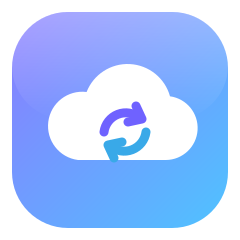
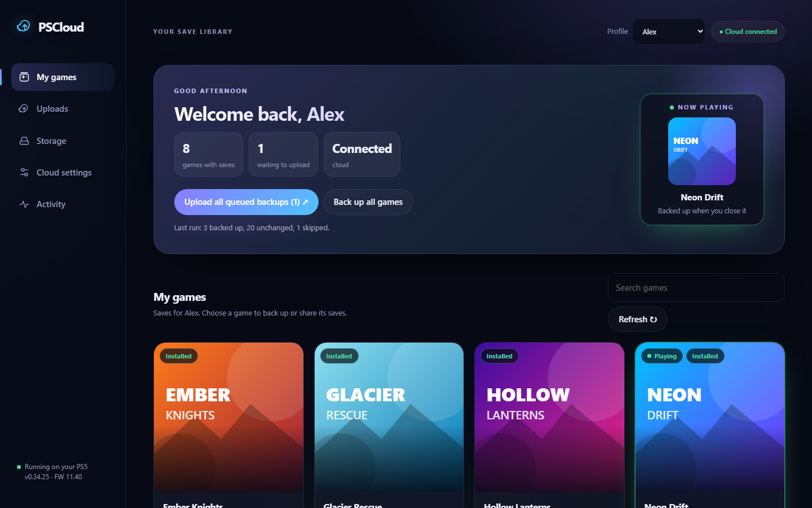
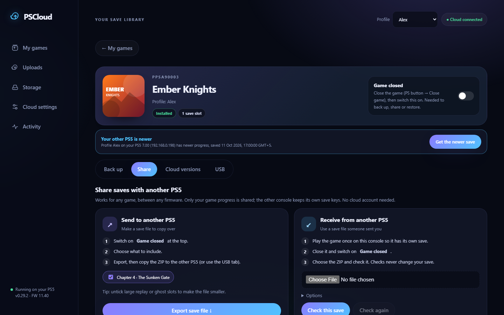
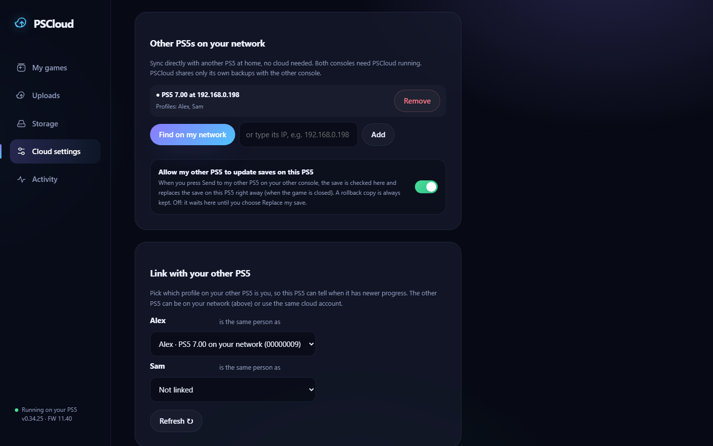
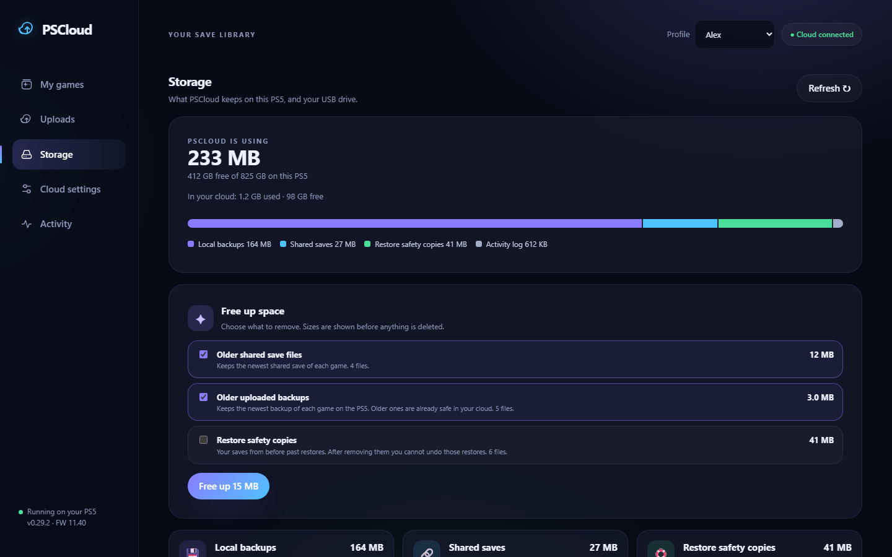

  

<h1 align="center">PSCloud</h1>

  <b>Back up, share and sync your PS5 game saves, from any browser.</b>

  
  
  

---

**PSCloud** runs as a single ELF payload on an already-jailbroken PS5 and serves its whole
interface over your home network.

There is nothing to install on your PC or phone. Send `pscloud-dashboard.elf` to the
console, open the PS5's IP address in a browser, and manage your saves from a desktop,
tablet or phone.

PSCloud brings together everything you need to keep your progress safe:

- Back up every game's saves, automatically when you close a game or every night;
- Keep versions in your own cloud (Nextcloud and other WebDAV services), optionally encrypted;
- **Sync between two PS5s**, over your home network or through the cloud;
- Share a save with a friend's PS5, between any firmware;
- Copy saves to a USB drive and bring them back;
- See exactly what is stored on the console, and free up space.

> **One payload. Your saves, on every PS5 you own.**

  
  

  
  

Screenshots use made-up demo games.

---

## ✨ Features

- **Back up when you close a game.** PSCloud notices when a game has really closed (not just
  between autosaves) and backs it up, with a notification on the PS5.
- **Back up all games** in one go, or **every night** at the hour you choose. Unchanged saves
  are skipped.
- **Readable save names.** Slots show the PS5's own labels, like "Slot 1 [Auto] A Debt
  Repaid", with each slot's picture.
- **Sync between your PS5s.** Link your profile on each console, then every game shows
  *In sync*, *This PS5 is newer*, *Your other PS5 is newer*, *Both changed*, *Only on this
  PS5* or *Other PS5 not reachable*.
  - **Over your home network**, no cloud needed: *Find on my network*, then sync.
  - **Get the newer save** or **Send to my other PS5** with one button.
  - **Sync this game**, per game: backs it up on close and brings newer progress over
    automatically. Turn it on once and it applies to both consoles.
- **Share saves with anyone.** Export a game's progress as a ZIP and receive one from
  another PS5. Only the progress is shared, and the receiving console keeps its own save keys.
- **Write saves this PS5 does not have yet** *(experimental)*. Missing slots are created the
  way the console creates saves, even when the game is not installed or was never played on
  this profile.
- **Sync compares real save times.** Each slot is compared by the time the game saved it,
  from the PS5's own save list, not by file dates.
- **Your own cloud.** Upload to Nextcloud, ownCloud, Koofr, pCloud, Box, Synology/QNAP and
  other WebDAV services over HTTPS. Each upload's size is checked before it counts, without
  downloading it again; a full download-and-compare check is optional. Choose how many
  versions to keep.
- **Encryption.** Optionally lock everything you upload with your own password (AES-256).
- **USB drives.** Save a game to an exFAT USB drive, copy all backups, and restore from it.
  The same save is never copied twice.
- **Storage you can see.** Everything PSCloud keeps lives in `/data/pscloud`. The Storage
  page shows what uses space, and **Free up space** shows sizes before anything is deleted.
- **Profiles.** Each PS5 profile has its own view: games, uploads and sync links.
- **Safe by design.** Restores and replaces only run on a closed game, after the save has
  been checked on a temporary copy, and a rollback copy of your current save is always
  kept.
- **Runs on your firmware.** Any firmware the PS5 payload SDK supports (1.00 to 13.60).

---

## 🚀 Getting started

1. **Jailbreak your PS5** and start an ELF loader (port 9021).
2. **Download** `pscloud-dashboard.elf` from the [latest release](https://github.com/bc160201983/ps5-cloud-save/releases/latest).
3. **Send it** to the console's ELF loader, for example with
   `python tools/send_payload.py <PS5-IP> pscloud-dashboard.elf`, or your usual payload sender.
4. **Open** `http://<PS5-IP>:8082` in a browser on the same network.
5. Optional: in **Cloud settings**, connect your cloud. For cloud uploads, copy
   `pscloud-ca.pem` from the release to `/data/pscloud/ca.pem`.

**Updating:** press **Stop PSCloud** on the dashboard, then send the new ELF. Your settings
are kept.

**Start with the console:** add the ELF to your autoloader, for example ProsperoMgr →
Payloads, then Settings → Autoloader.

---

## 🔁 Syncing two PS5s

1. On each console, go to **Cloud settings → Other PS5s on your network** and choose **Find
   on my network**, then **Add**. You can also type the other console's IP.
2. Under **Link with your other PS5**, pick the matching profile.
3. Open a game. The banner tells you which console is newer.
4. Use **Get the newer save** or **Send to my other PS5**, or switch on **Sync this game**.

To let your other PS5 replace saves here without you confirming, turn on **Allow my other
PS5 to update saves on this PS5**. A rollback copy is still kept.

---

## 🧪 Status

| | |
|---|---|
| **Tested on consoles (7.00 and 11.40)** | Backups and uploads; game-close backup; sharing between 7.00 and 11.40 (Marvel's Wolverine loaded in-game); readable save names; storage view; finding the other PS5 on the network |
| **Tested on consoles, in parts** | Creating a save container and adding a slot to the PS5's save list (test payloads on 7.00 and 11.40); game keystones are identical across consoles |
| **Tested only by automated tests** | A full sync or send between two consoles; per-slot save-time comparison; creating missing slots and writing saves of games not installed or never played (system menu and in-game loading not yet checked); size-only upload check; encryption against a real cloud; USB drives; nightly backup; behaviour in rest mode |
| **Firmware** | Tested on 7.00 and 11.40. Other firmware from 1.00 to 13.60 is supported but not yet tested; the dashboard says so. |

Each release in the [changelog](CHANGELOG.md) lists exactly what was verified on a console.

---

## 📁 Where PSCloud keeps files

Everything is in `/data/pscloud/` on the PS5. Your own saves in `/user/home/<profile>/` are
only read, except when you choose Restore or Replace. Creating a missing slot also adds one
row to the PS5's save list (a copy is kept first). See
[docs/where-files-live.md](docs/where-files-live.md) for every folder and what is kept
automatically.

---

## 🔒 Privacy and safety

- The dashboard has **no password**. Anyone on your home network can open it, so never expose
  ports 8082 or 8083 to the internet.
- Cloud transfers use **HTTPS**, and your cloud password and encryption password stay on the
  PS5.
- Another PS5 on your network can only **read** PSCloud's own backups. It can ask this PS5
  to fetch a newer save, but this PS5 replaces a save only if you allowed it.

---

## ❓ FAQ

**Does it work without a cloud account?**
Yes. Backups, USB, sharing and syncing two PS5s on your network all work without one.

**Will it work with my game?**
Sharing and syncing work for PS5 games in general. Some games tie saves to an account or
region, so always check the game after replacing a save. A rollback copy is kept. PS4 game
saves are not supported yet.

**Can I use Dropbox, Google Drive or an SMB share?**
Not yet. Any WebDAV service works today, and most NAS boxes offer WebDAV.

**Something went wrong. Where do I look?**
Open **Activity** in the dashboard, which is the log from `/data/pscloud/pscloud.log`.

---

## 🛠️ Building

The payloads are built by GitHub Actions with the [PS5 payload SDK](https://github.com/ps5-payload-dev/sdk);
see `.github/workflows/build.yml`. Host tests run with `make test` (Linux, `libcurl`,
`libcrypto`). A local design preview runs with `python tools/preview_dashboard.py` (add
`--demo` for the made-up demo games used in the screenshots).

---

## 📜 Changelog

See [CHANGELOG.md](CHANGELOG.md).
